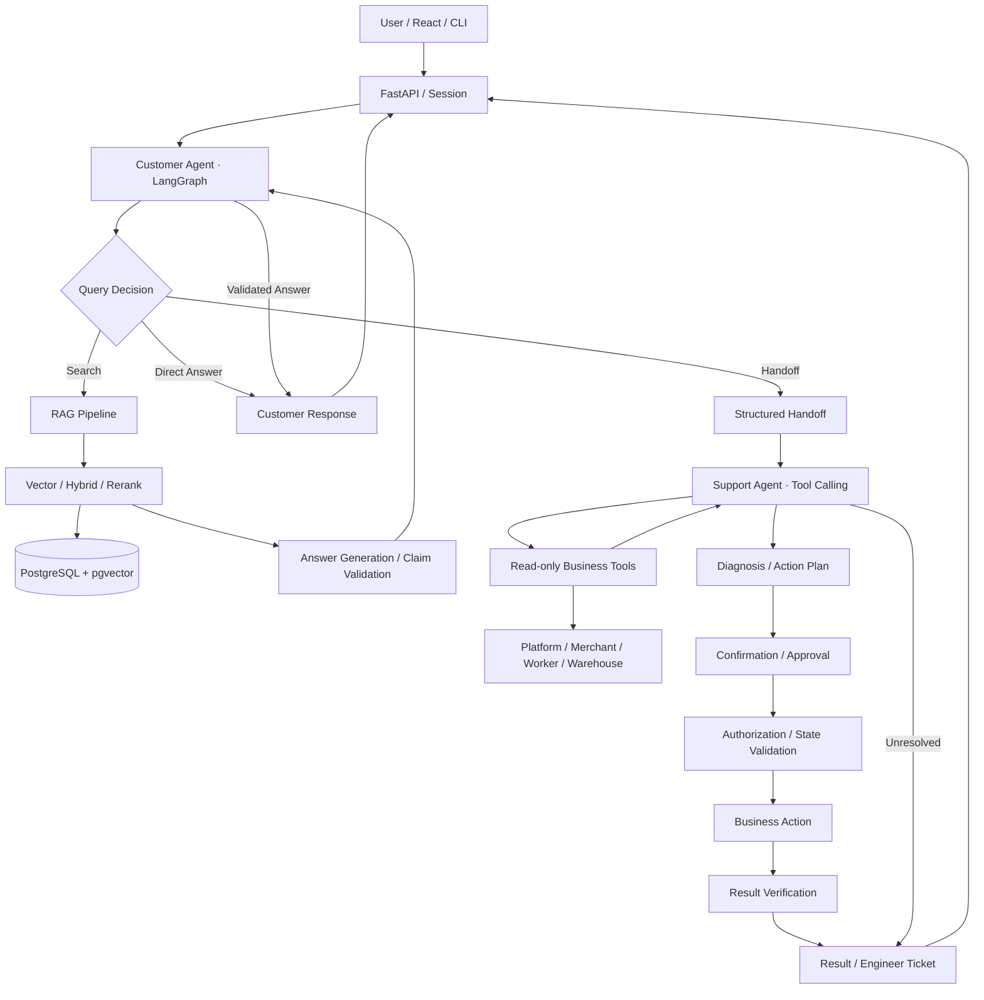

# ResolveAI

**企业级双 Agent 智能客服与业务执行系统**

基于 **LangGraph、RAG、FastAPI 和 PostgreSQL** 构建的双智能体（Dual-Agent）系统，实现从产品知识问答、业务问题诊断到安全操作执行的完整工作流。

## 项目简介

ResolveAI 面向电商 SaaS 平台的技术支持场景，通过两个 Agent 协作处理不同类型的问题：

- **Customer Agent**：负责产品知识问答、RAG 检索、引用验证和问题澄清。
- **Support Agent**：负责业务状态调查、动态工具调用、问题诊断和操作建议。

当产品知识无法解决问题时，Customer Agent 通过结构化 Handoff 将问题交接给 Support Agent。后者调查真实业务状态，在用户确认或管理员审批后，由确定性程序执行操作并验证结果。

项目构建了本地 **Platform、Merchant、Warehouse、Worker** 模拟业务环境，覆盖订单导入失败、发货状态不一致、库存同步异常等典型场景，重点验证 Agent 协作、可靠执行及工程化评估能力。

## 核心成果

基于历史 Evaluation 与优化记录：

| 评估指标 | 优化结果 |
|---|---|
| 任务成功率（Task Success） | **65% → 97.5%** |
| 工具选择与参数准确率 | **97.5%** |
| RAG Recall@5 | **95%** |
| P95 响应延迟 | **112.6s → 23.6s** |
| Safety 开发测试 | **20/20 通过** |
| Reliability 开发测试 | **76.9% → 100%** |

> 以上为不同历史评测阶段的结果，不代表当前版本重新完成了统一验收。延迟结果来自 5 次代表性请求；Safety 与 Reliability 指标基于有限的确定性测试场景。详细记录见 [Benchmark History](evals/BENCHMARK_HISTORY.md)。

## 系统架构



**架构设计原则：LLM 负责语义理解与决策建议，确定性程序负责权限检查、业务执行及结果验证。**

两个 Agent 通过结构化 Handoff 协作，不共享不必要的后台访问权限。Customer Agent 不能直接读取订单或库存数据，Support Agent 不能绕过审批自行执行写操作。

详细设计见 [Architecture](docs/architecture.md)。

## 核心技术实现

### 1. Dual-Agent Workflow

使用 **LangGraph** 编排 Agent 工作流，将知识问答和业务调查拆分为两个独立职责。

- Customer Agent 根据用户问题选择直接回答、RAG 检索或 Handoff。
- Support Agent 根据已有证据动态选择工具，并在调查完成后生成诊断结论及候选操作。
- 结构化 Handoff 传递用户问题、已尝试步骤、已知业务标识和缺失信息。
- 调查设置调用次数、执行时间和错误预算，避免无限循环。

### 2. RAG 检索与回答验证

基于 **PostgreSQL + pgvector** 构建产品知识检索系统。

- 支持 Markdown、PDF、DOCX、XLSX 等资料导入与分块。
- 提供 Vector、Hybrid、Hybrid + Rerank 三种检索模式。
- 支持公司、产品、版本及有效期等元数据过滤。
- 结合 Query Rewrite、Retrieval Diversity 优化查询与结果覆盖。
- 通过 Claim Validation 检查生成答案的引用范围、版本及原文支持。

历史正常执行路径由 3–4 次 LLM 调用减少到通常 1–2 次；在保留确定性引用检查的同时，减少重复模型调用。

详细记录见 [RAG Optimization](evals/optimization/rag.md)。

### 3. Tool Calling 与业务诊断

Support Agent 通过动态工具调用调查后台状态，而不是仅根据用户描述猜测问题。

支持的业务场景包括：

- 订单导入失败与重试
- 发货状态不一致与补传
- 库存发布异常与刷新
- 店铺连接状态调查
- 故障升级与 Engineer Ticket

模型负责选择只读工具并提出候选动作；具体执行权限由业务代码控制。

### 4. 安全执行与故障恢复

通过 **Authorization、Approval、Idempotency 和 Result Verification** 实现受控业务操作。

- **权限控制**：根据用户身份和动作范围执行确认或管理员审批。
- **执行前验证**：重新检查权限、业务对象和最新状态，防止使用过期证据。
- **幂等处理**：使用稳定请求编号、数据库唯一约束及执行租约避免重复业务效果。
- **故障恢复**：发生响应丢失或超时时，先查询原请求结果，避免重复执行。
- **结果验证**：操作完成后读取真实业务状态，不直接将 API 请求成功视为业务成功。

系统追求 **Effectively-once Business Effect**，不承诺分布式环境中的严格 Exactly-once Execution。

### 5. Evaluation 与性能优化

使用固定测试案例、Ground Truth、确定性业务断言及模型辅助评审评估 Agent 表现。

评估主要覆盖：

| 维度 | 评估内容 |
|---|---|
| Workflow | 任务成功率、工具选择与参数准确率 |
| RAG | Recall@5、回答质量、引用有效性 |
| Safety | 权限绕过、未授权执行、不安全业务效果 |
| Reliability | 重复执行、结果未知恢复、错误成功判定 |
| Performance | P95 Latency、LLM Calls、Token Usage |

通过 **LangSmith Tracing** 分析调用链路，定位串行调用、冗余 Review 和重复上下文等问题。

采用 Development、Regression 和 Holdout 案例区分开发优化与独立验证，并保存历史 Benchmark，避免仅凭单次评分判断优化效果。

历史 RAG 评测中，同一批 30 个检查项的自动评分为 19/30，经离线评分审计修订为 26/30。这属于评分修正，并非 Agent 重新执行后的性能提升；相关差异和剩余失败均在评测记录中保留。

详细结果见 [Evaluation](evals/README.md)、[Benchmark History](evals/BENCHMARK_HISTORY.md) 和 [Performance Optimization](evals/optimization/performance.md)。

## 技术栈

| 分类 | 技术 |
|---|---|
| Agent Framework | LangGraph、LangChain |
| LLM Application | Tool Calling、Structured Output、RAG |
| Backend | Python、FastAPI、Pydantic |
| Database | PostgreSQL、pgvector、SQL |
| Frontend | React |
| Observability | LangSmith |
| Testing | Pytest、Ground Truth、Regression Testing |
| Infrastructure | Docker、Docker Compose |

## 项目结构

```text
resolve-ai/
├── backend/          # API、Agent、RAG、工具调用、安全执行
├── frontend/         # React 前端
├── simulator/        # 模拟业务平台及 Worker
├── infra/            # 数据库迁移
├── tests/            # 单元测试与确定性回归测试
├── evals/            # Evaluation、Benchmark、优化记录
├── docs/             # 架构与演示文档
└── docker-compose.yml
```

## 快速开始

**环境要求：** Python 3.11+、Node.js 22+、Docker Desktop。

### 1. 安装与启动后端

在项目根目录执行（Windows PowerShell）：

```powershell
Copy-Item .env.example .env
python -m venv .venv
.\.venv\Scripts\python -m pip install -r requirements.lock
```

编辑 `.env`，配置本地数据库密码、模型及 Embedding 参数。

```powershell
docker compose up -d --build
```

检查服务状态：

```powershell
Invoke-RestMethod http://127.0.0.1:8000/api/v1/health
```

### 2. 导入知识库

配置 Embedding 服务后执行：

```powershell
.\.venv\Scripts\python -m backend.app.cli docs import
```

### 3. 启动前端

```powershell
cd frontend
npm ci
npm run dev
```

访问：

- Frontend：http://127.0.0.1:5173
- API Docs：http://127.0.0.1:8000/docs

本地演示凭证由初始化程序生成，存储在 `.local/test_tokens.json`。

### 4. 运行测试

```powershell
.\.venv\Scripts\python -m pytest
```

验证 Evaluation 数据集配置（不执行真实评测）：

```powershell
.\.venv\Scripts\python -m evals.run --validate
```

完整业务演示见 [Demo Guide](docs/demo.md)。

## 文档与评测记录

- [系统架构](docs/architecture.md)
- [业务演示](docs/demo.md)
- [产品知识库](docs/product-catalog.md)
- [Evaluation 设计](evals/README.md)
- [Benchmark 历史](evals/BENCHMARK_HISTORY.md)
- [Workflow 优化](evals/optimization/workflow.md)
- [RAG 优化](evals/optimization/rag.md)
- [Safety 优化](evals/optimization/safety.md)
- [Reliability 优化](evals/optimization/reliability.md)
- [Performance 优化](evals/optimization/performance.md)

## 已知限制

- 当前使用本地业务 Simulator，未直接集成真实电商平台与物流服务。
- Evaluation 数据集规模有限，历史结果不等于生产环境表现。
- RAG 仍存在答案完整性及语义判断方面的边界问题。
- 当前代码尚未完成新的统一质量与性能验收，历史指标应结合 Benchmark 记录理解。
